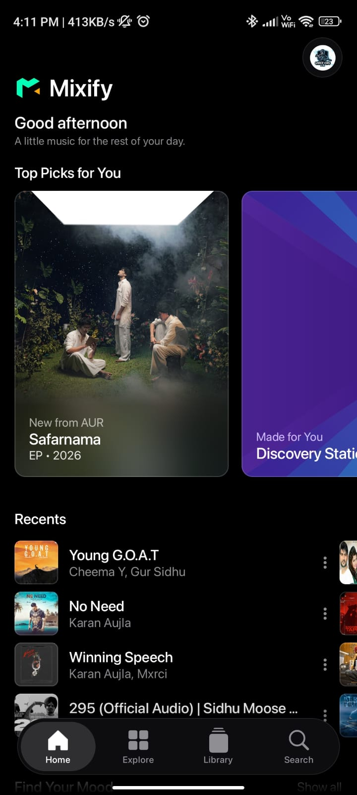
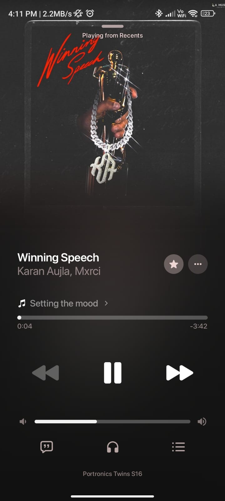
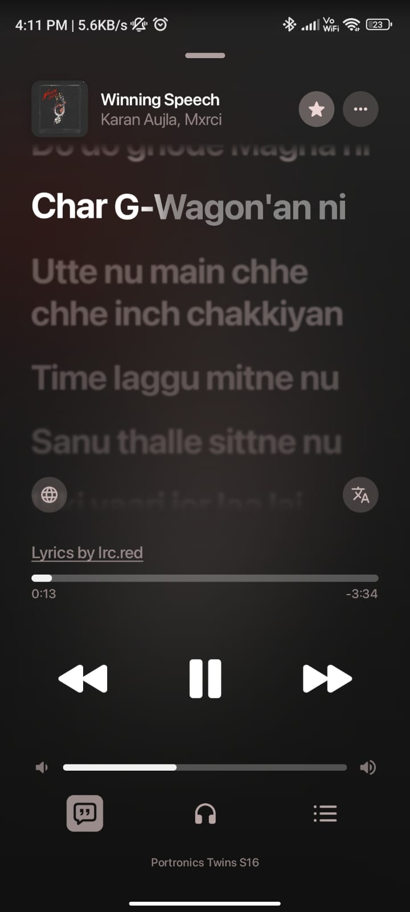
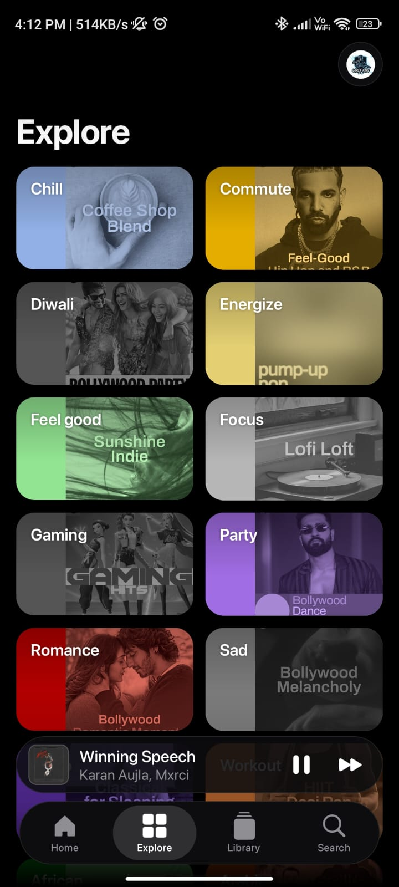
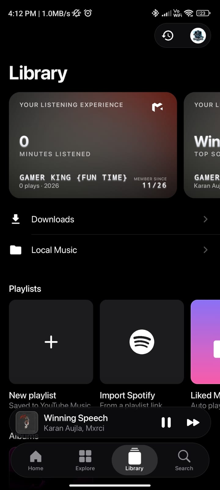
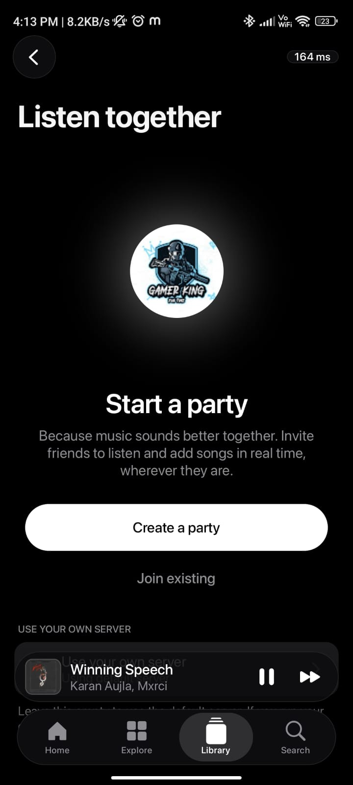
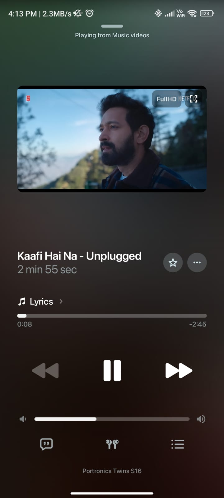
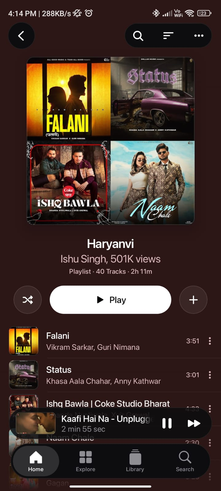

<div align="center">

<a href="https://mixify.co.in/">
  
</a>

<h1>Mixify</h1>

A modern music experience for Android.

[](https://github.com/MixifyTeam/Mixify/releases/latest)
[](https://github.com/MixifyTeam/Mixify/releases)
[](LICENSE)


**[Download APK](https://github.com/MixifyTeam/Mixify/releases/latest) · [Website & Features](https://mixify.co.in/) · [Telegram](https://t.me/mixify20)**

<a href="https://alternativeto.net/software/mixify-android/about/?utm_source=badge&utm_medium=referral">
  
</a>

[](https://trendshift.io/repositories/289766)

</div>

<h2 align="center">About Mixify</h2>

Mixify is a free, open-source Android music app maintained by Priyanshu Sharma.

Version 1.0.7 brings Mixify’s identity to a refreshed interface based on BitChord, with an updated Home screen, app information, and sharing experience.

Explore the screenshots below, download the latest release, or visit the [official website](https://mixify.co.in/) for features and updates.

<h2 align="center">Screenshots</h2>

<p align="center">Mixify 1.0.7 preview.</p>

<table align="center">
  <tr>
    <th align="center">Home</th>
    <th align="center">Player</th>
    <th align="center">Lyrics</th>
    <th align="center">Explore</th>
  </tr>
  <tr>
    <td align="center"></td>
    <td align="center"></td>
    <td align="center"></td>
    <td align="center"></td>
  </tr>
  <tr>
    <th align="center">Library</th>
    <th align="center">Listen Together</th>
    <th align="center">Video Player</th>
    <th align="center">Playlist</th>
  </tr>
  <tr>
    <td align="center"></td>
    <td align="center"></td>
    <td align="center"></td>
    <td align="center"></td>
  </tr>
</table>

<p align="center">
  Explore the full feature list and more screenshots on
  <a href="https://mixify.co.in/">mixify.co.in</a>.
</p>

<h2 align="center">Download & Installation</h2>

<p align="center">
  <a href="https://github.com/MixifyTeam/Mixify/releases/latest"></a>
  &nbsp;
  <a href="https://mixify.co.in/"></a>
  &nbsp;
  <a href="https://apkpure.com/p/com.mixify.app"></a>
</p>

1. Open the official website or GitHub release page.
2. Read the release notes and choose the phone APK that matches your device, or the universal APK when available.
3. Open the downloaded APK and allow installation from that source if Android asks.
4. Install Mixify and start listening.

For updates, install over your existing app using a compatible APK signed with the same key. Avoid uninstalling first if you want to keep your local app data.

Availability on third-party stores can differ from GitHub.

<p align="center">
  <a href="https://github.com/MixifyTeam/Mixify/releases">View all releases</a>
</p>

<h2 align="center">Community</h2>

<p align="center">
  Join the community for release announcements, discussion and feedback.
</p>

<p align="center">
  <a href="https://t.me/mixify20"></a>
  &nbsp;
  <a href="https://t.me/MixifyCommunityy"></a>
  &nbsp;
  <a href="https://discord.gg/qtVYB2wyH3"></a>
</p>

<h2 align="center">Support & Sponsor</h2>

Mixify is free and open-source. You can support development by starring the repository, sharing the app, reporting bugs, improving documentation, or contributing code.

Sponsorship helps fund ongoing maintenance, fixes, and development.

<p align="center">
  <a href="https://github.com/sponsors/scisims12"></a>
  &nbsp;
  <a href="https://github.com/MixifyTeam/Mixify"></a>
</p>

Thank you to everyone who supports the project.

<h2 align="center">Bug Reports & Suggestions</h2>

[Report a bug or suggest an improvement](https://github.com/MixifyTeam/Mixify/issues).

For bug reports, please include:

- Mixify version and build type.
- Android version and device model.
- What happened and steps to reproduce it.
- A screenshot or screen recording, if useful.
- Relevant logs with private information removed.

<h2 align="center">Contributing</h2>

Contributions are welcome! For bug fixes or improvements:

1. Check existing issues before starting.
2. Fork the repository and create a branch.
3. Make and test your changes.
4. Open a pull request describing what changed and how you tested it.

### Building from source

Clone the repository:

```bash
git clone https://github.com/MixifyTeam/Mixify.git
cd Mixify
```

Open the project in Android Studio and let Gradle sync.

<div align="center">
  <h2>Thanks to all contributors ❤️</h2>
  <p>Thanks to everyone who helps improve Mixify!</p>
  <a href="https://github.com/MixifyTeam/Mixify/graphs/contributors">
    
  </a>
  <p><a href="https://github.com/MixifyTeam/Mixify/graphs/contributors">View all contributors</a></p>
</div>

<h2 align="center">Credits & Project Origins</h2>

**Mixify 1.0.7 is based on BitChord 1.9 by [kushagrasinghx](https://github.com/kushagrasinghx).** Mixify's branding, configuration and subsequent changes are maintained by [Priyanshu Sharma](https://github.com/scisims12).

Mixify builds on existing open-source work. It does not claim that all of its code, design or functionality was created from scratch. Original authorship, copyright notices and applicable licenses must be preserved.

<h3 align="center">Special Thanks</h3>

<table align="center">
  <tr>
    <th>Project</th>
    <th>Credit</th>
  </tr>
  <tr>
    <td>BitChord</td>
    <td>kushagrasinghx — the base for this version's interface and code</td>
  </tr>
  <tr>
    <td><a href="https://github.com/z-huang/InnerTune">InnerTune</a></td>
    <td>Zion Huang, Malopieds and contributors</td>
  </tr>
  <tr>
    <td><a href="https://github.com/DD3Boh/OuterTune">OuterTune</a></td>
    <td>Davide Garberi, Michael Zh and contributors</td>
  </tr>
  <tr>
    <td><a href="https://github.com/vfsfitvnm/ViMusic">ViMusic</a></td>
    <td>vfsfitvnm and contributors — an inspiration acknowledged by InnerTune</td>
  </tr>
  <tr>
    <td><a href="https://better-lyrics.boidu.dev">Better Lyrics</a></td>
    <td>Lyrics project acknowledged in Mixify's earlier documentation</td>
  </tr>
</table>

Thank you to the developers and maintainers of the libraries, tools and services used by this project. Refer to the source and in-app open-source notices for dependency-specific attribution.

**Developer links:** [Portfolio](https://portfolio.mixify.co.in/) · [GitHub](https://github.com/scisims12) · [Instagram](https://www.instagram.com/sharmaajikabadabeta/)

<h2 align="center">Privacy</h2>

<p align="center">
  <a href="https://mixify.co.in/privacy">Privacy Policy</a>
  ·
  <a href="https://mixify.co.in/terms">Terms & Conditions</a>
</p>

The anonymous live listening counter is optional and **OFF by default**. To contribute, enable **Share anonymous live listening status** in Settings.

The public badge shows participating listeners, not total installations or all active users.

<h2 align="center">Security</h2>

Never commit or attach secrets to public issues or pull requests. Keep these private:

- `.env`, `local.properties` and `key.properties` files.
- Signing keys such as `.jks` and `.keystore` files.
- API keys, access tokens, passwords and service account credentials.
- Logs or screenshots containing personal information.

If a secret is exposed, revoke or rotate it and remove it from the repository's history where appropriate.

For a security-sensitive issue, avoid posting exploit details or credentials publicly. Use GitHub's private vulnerability reporting option if available, or ask the maintainer for a private reporting channel without disclosing sensitive details.

<h2 align="center">FAQ</h2>

**Where can I find the latest version?**

Use [GitHub Releases](https://github.com/MixifyTeam/Mixify/releases/latest) or the [official website](https://mixify.co.in/).

**What does Total Downloads count?**

Downloads of release assets across this GitHub repository. It is not a count of unique users or installations and does not include other stores.

**Where is the full feature list?**

Visit [mixify.co.in](https://mixify.co.in/). This README focuses on getting started and project information.

<h2 align="center">License</h2>

Mixify is distributed under the **GNU General Public License v3.0**. Read [LICENSE](LICENSE) for the full terms. Preserve the original copyright and license notices when modifying or redistributing the project.

Third-party libraries and assets retain their applicable licenses.

<h2 align="center">Disclaimer & Legal Notice</h2>

Mixify is an independent, open-source Android music player and third-party client. It is not affiliated with, endorsed by, or sponsored by Google LLC, YouTube, YouTube Music, or other third-party services accessed through the app.

- **Third-Party Content:** Music, videos, lyrics, artwork, trademarks, and other third-party content belong to their respective owners. Mixify does not claim ownership of this content.

- **Responsible Use:** Use Mixify only to access, play, or download content you are authorized to use. Users must comply with applicable laws and the terms of the services they access. Open-source availability does not grant rights to third-party content.

- **Service Availability:** Features that depend on third-party services may change, become unavailable, or stop working without notice. Uninterrupted access, compatibility, and ad-free playback are not guaranteed.

- **Open-Source Attribution:** Mixify builds on existing open-source projects, including BitChord. Original authorship, copyright notices, and applicable licenses must be preserved.

- **License:** Mixify is distributed under the GNU General Public License v3.0. Modification and redistribution are subject to its terms, including applicable source-code obligations. Third-party components and content retain their respective licenses and rights.

- **No Warranty:** Mixify is provided without warranty, to the extent permitted by applicable law. See the LICENSE file for the full warranty disclaimer and limitation of liability.
---

<p align="center">
  <a href="#about-mixify">About</a> ·
  <a href="#screenshots">Screenshots</a> ·
  <a href="#download--installation">Download</a> ·
  <a href="#community">Community</a> ·
  <a href="#support--sponsor">Support</a> ·
  <a href="#credits--project-origins">Credits</a> ·
  <a href="#security">Security</a>
</p>

<p align="center">
  <strong>Mixify — Listen. Discover. Enjoy.</strong>
</p>

<p align="center">
  <a href="https://portfolio.mixify.co.in/"></a>
  &nbsp;
  <a href="https://mixify.co.in/"></a>
  &nbsp;
  <a href="https://github.com/sponsors/scisims12"></a>
</p>
